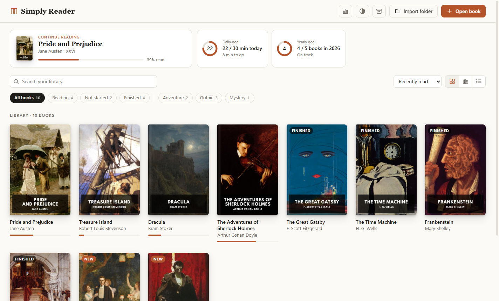
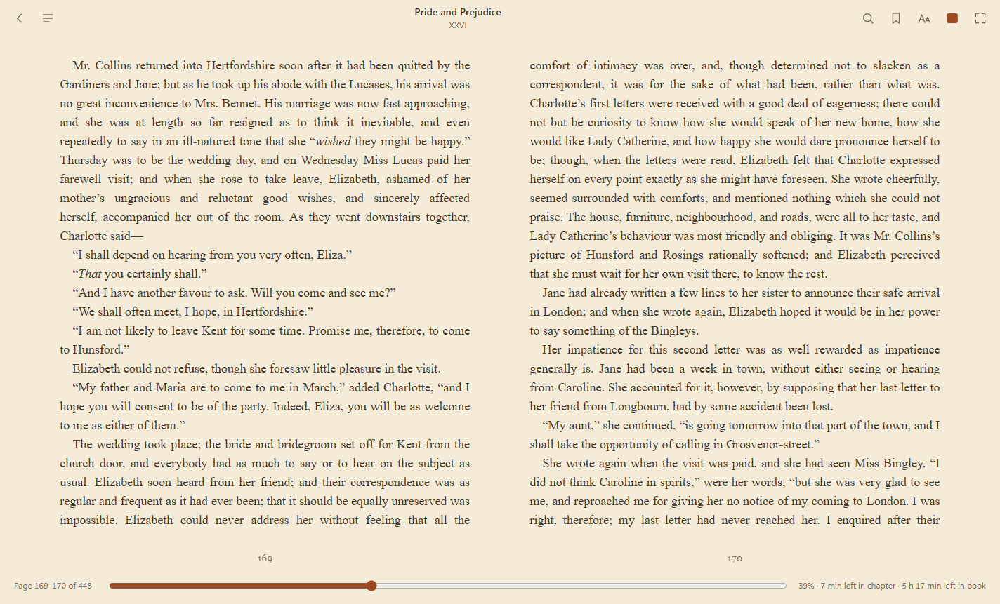
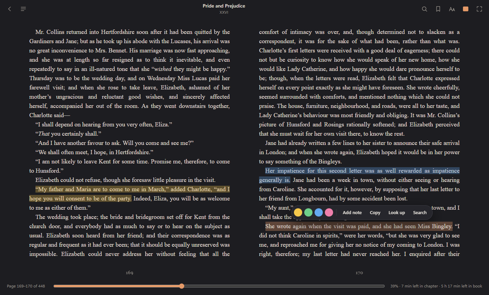
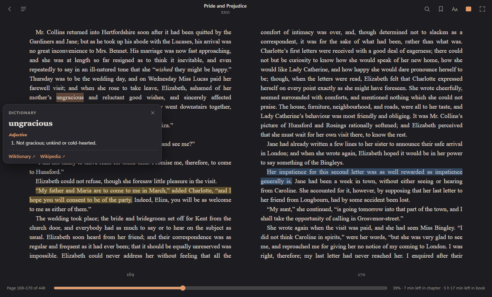
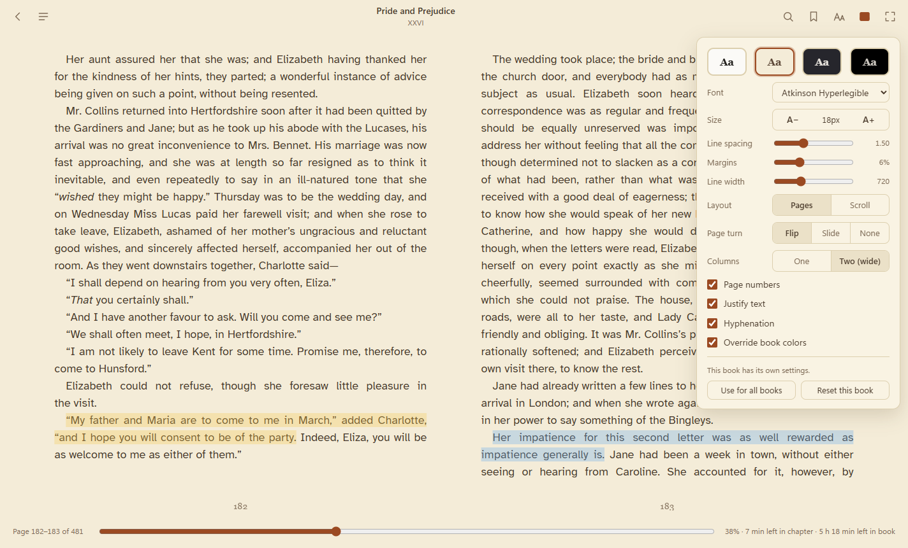
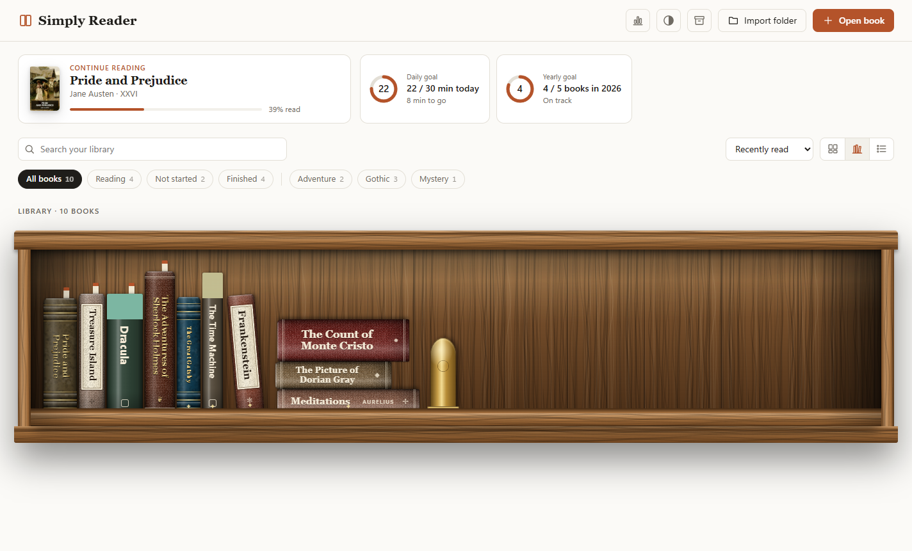
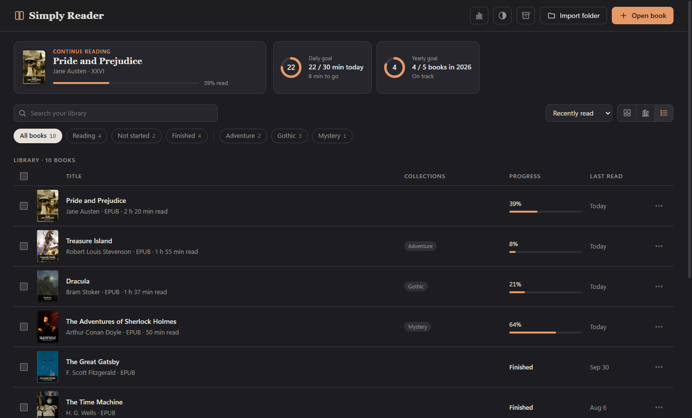
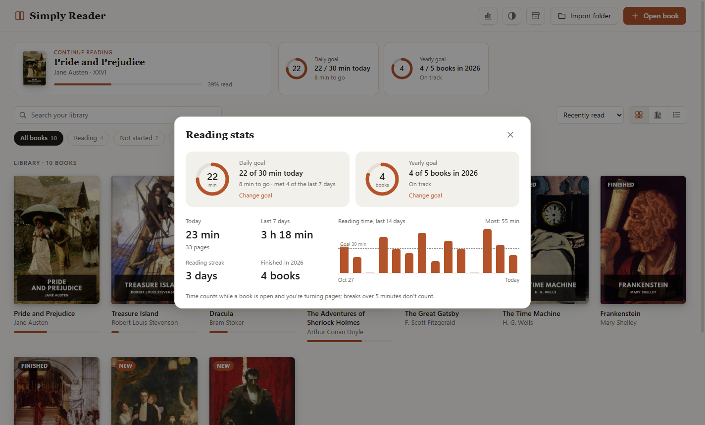
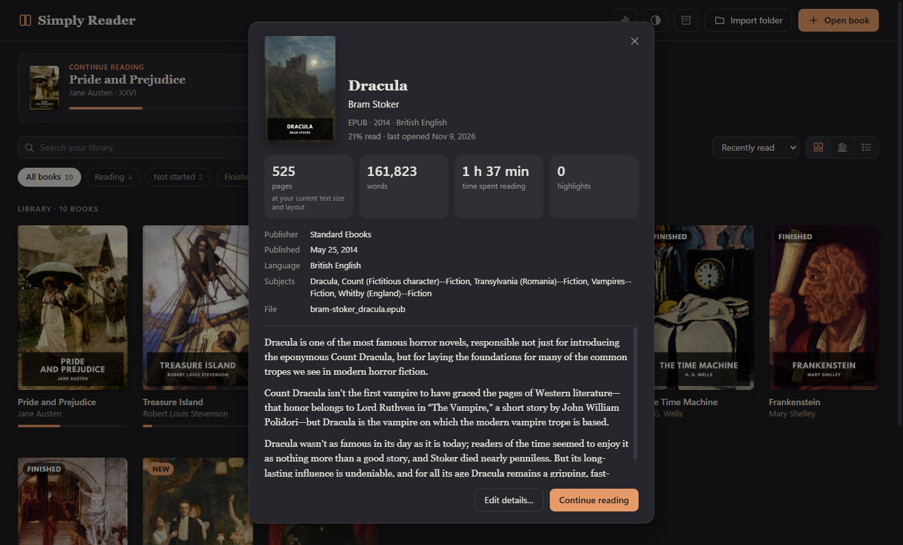
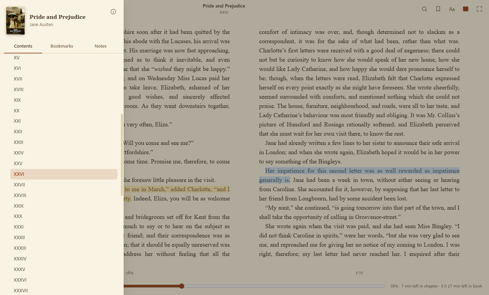

# Simply Reader

A calm, fast desktop e-book reader for Windows. It opens **EPUB, MOBI, AZW3/AZW, KF8/PRC, FB2/FBZ, CBZ and PDF** files, keeps your library in one place, and remembers where you stopped in every book.

**[Download the latest version](https://github.com/unkindee/simply-reader/releases/latest)**: an installer, or a portable `.exe` that runs without installing.



- [Screenshots](#screenshots)
- [Install](#install)
- [Features](#features)
  - [Your library](#your-library)
  - [Reading](#reading)
  - [Looking things up](#looking-things-up)
  - [Highlights, notes and bookmarks](#highlights-notes-and-bookmarks)
  - [Reading stats and goals](#reading-stats-and-goals)
  - [Backup and restore](#backup-and-restore)
  - [PDFs and comics](#pdfs-and-comics)
- [Keyboard shortcuts](#keyboard-shortcuts)
- [Where your data lives](#where-your-data-lives)
- [Privacy](#privacy)
- [Run from source](#run-from-source)
- [Credits](#credits)

## Screenshots

*The books shown are public-domain classics from [Standard Ebooks](https://standardebooks.org).*

| | |
|---|---|
|  |  |
| **Reading**: two pages side by side, real page numbers, and time left based on your reading speed | **Highlights and notes**: four colours, plus Copy, Look up and Search on any selection |
|  |  |
| **Look up**: dictionary definitions and Wikipedia, right next to the text | **Settings**: themes, fonts and layout, remembered per book |
|  |  |
| **Bookshelf view**: spines coloured from each cover | **List view**: details at a glance, with multi-select |
|  |  |
| **Reading stats and goals**: progress rings and a 14-day chart | **Book info**: description, details, length and your time spent |
|  | |
| **Contents**: chapters, bookmarks and notes in one drawer | |

## Install

Download from the **[Releases page](https://github.com/unkindee/simply-reader/releases/latest)**:

| File | What it does |
|---|---|
| `SimplyReader-Setup-1.0.0.exe` | Installs the app, adds a Start-menu entry, and registers it as the "Open with" app for e-book files. You can choose the install folder. |
| `SimplyReader-Portable-1.0.0.exe` | Runs without installing. Your library is still kept in `%APPDATA%\Simply Reader`. |

The app isn't code-signed yet, so Windows SmartScreen may warn the first time you run it: click **More info → Run anyway**. When you build from source, the same files appear in `dist/` (the installer is named `Simply Reader Setup 1.0.0.exe` there).

Double-clicking a book while Simply Reader is already open opens it in the same window.

## Features

### Your library

- **Three views**, switched with the buttons above the book list:
  - **Covers**: a grid of high-resolution covers with a progress bar under each.
  - **Bookshelf**: books as spines on wooden shelves. Each spine's colour comes from its cover and its thickness from the book's length. A ribbon marks books you're reading, and hovering over a spine shows the cover.
  - **List**: one row per book with its title and author, collections, progress and when you last read it.
- **Continue reading**: a compact card at the top takes you back to the last book you opened, at the page where you stopped. Your reading goals sit beside it.
- **Search and sort**: search by title or author. Sort by recently read, recently added, title, author or progress.
- **Filters and collections**:
  - Built-in filter chips: *All books*, *Reading*, *Not started* and *Finished*.
  - Put books in your own collections (⋯ → *Collections…*). Each collection gets its own chip.
  - Right-click a collection chip to rename or delete it.
- **Select several books** in list view:
  - Tick the checkboxes, Shift-click to select a range, or use the header box (or Ctrl+A) to select everything shown.
  - Remove the selected books in one go from the bar at the bottom, or with Delete.
- **Book info** (⋯ → *Book info*, or ⓘ in the reader's Contents drawer) shows:
  - The cover, description, publisher, publication date, language, subjects, series and ISBN.
  - **Pages and words** (the word count comes from the book's text).
  - **Your time spent reading** the book, and your **highlight, note and bookmark** counts.
- **Edit details** (⋯ → *Edit details…*): change a book's title, author or cover.
  - **Find online** suggests matching titles, authors and large covers from Apple Books and Open Library; click one to use it.
  - Your edits stay, even when the book is reopened.
- **Adding books**: *Open book* (Ctrl+O), *Import folder* (adds every e-book in a folder and its subfolders), drag and drop onto the window, or double-click a file in Explorer.
- **Books are copied into the library.** Every book you add is copied into the app's own folder, so you can move or delete the original. Removing a book from the library deletes only that copy, never your original file.
- **Theme picker**: the half-circle button in the header switches the whole app between Light, Sepia, Dark and Black.

### Reading

- **Layout**: one or two pages side by side, or one continuous scroll. In two-page mode you read the left page, then the right.
- **Text**: font (including the bundled, very legible *Atkinson Hyperlegible*), size, line spacing, margins, line width, justification, hyphenation, and an option to override the book's own colours.
- **Per-book settings**:
  - Each book remembers its own font, size, spacing, margins, layout and PDF zoom, so a PDF and a novel never fight over one setting.
  - The settings panel says whether the book uses your defaults or its own settings. **Use for all books** makes a book's settings your new defaults; **Reset this book** returns it to them.
  - Theme, page-turn style, page numbers and the footer are shared by all books.
- **Real page numbers**:
  - Shown under each page, plus "Page 45–46 of 312" at the bottom.
  - They're counted in the background for your actual window size and font, so they're exact, and they're recounted when the layout changes.
  - A chapter ending on a left page doesn't create a phantom page.
- **Go to page** (Ctrl+G, or click the page number at the bottom left): jump to any page, and use **Back** to return to where you were.
- **Page-turn effects**: a 3D page flip with shading, a slide, or none.
- **Time left**: "12 min left in chapter · 6 h 40 min left in book", based on *your* reading speed, which the app learns as you read.
- **Progress footer**: hidden until you move the mouse to the bottom of the page, or always shown. Toggle it with the button left of full screen.
- **Distraction-free**: click the middle of a page (or press `I`) to hide the toolbars; F11 or `F` for full screen.
- **Footnotes** open in a small pop-up next to the text instead of jumping away. **Go to note** opens the note where it appears in the book.
- **Click a picture to zoom**:
  - Maps, illustrations and diagrams open full screen.
  - Zoom with the mouse wheel, double-click or +/−; drag to move around.
  - Esc or a click beside the picture closes it.
- **Search inside the book** (Ctrl+F), with every match listed with the text around it.
- **Table of contents** (`T`), with the current chapter marked.
- **Links**: links inside a book work, and Alt+← takes you back.

### Looking things up

Select a word or phrase and click **Look up**:

- **Dictionary definitions** from Wiktionary, in the book's language when available, otherwise in English.
- **Wikipedia summaries** for names, places and phrases, with a link to the full article.

### Highlights, notes and bookmarks

- **Highlights** in four colours (yellow, green, blue, pink): select text and pick a colour.
- **Notes** of any length on any passage. Passages with notes get a dotted underline; click one to read or edit its note.
- **Bookmarks**: Ctrl+B or the bookmark button, which is highlighted when the page is bookmarked.
- The **Notes** tab lists all highlights and notes, and **Export…** saves them as a Markdown file.
- The selection pop-up also has **Copy**, **Search in book** and **Look up**.

### Reading stats and goals

The chart button in the header opens **Reading stats**:

- **Goals**, each shown as a progress ring:
  - **Daily goal**: minutes a day, for example "20 of 30 min today".
  - **Yearly goal**: books a year, for example "8 of 24 books in 2026", with whether you're ahead of or behind schedule.
  - Set them with quick choices (10/20/30/60 minutes, 12/24/52 books) or any number.
  - A short message appears the moment you reach today's goal while reading.
  - Both goals are also shown beside *Continue reading* in the library.
- **Tiles**: time read today, the last 7 days, your reading streak, and books finished this year.
- **A 14-day chart** of reading time, with a dashed line at your daily goal. Hover over a day to see its time and pages.

Reading time counts only while a book is open, the window is visible, and you're actually reading; breaks over 5 minutes don't count.

### Backup and restore

The box button in the header opens **Backup & restore**:

- **Back up now** saves everything in one `.zip` file: your books, reading positions, highlights, notes, bookmarks, collections, covers, edited details, per-book settings, book info, reading stats, goals and settings.
- **Automatic backup**: once a week, to a folder you choose. A OneDrive or Dropbox folder keeps a copy off your computer. The 5 newest are kept.
- **Restore** replaces your library with a backup. Your current library is saved first, so a restore can always be undone.
- **New computer or empty library?** Click **Restore a backup** on the empty-library screen (or the backup button in the header) to bring everything back in one step.

### PDFs and comics

- PDFs use Mozilla's pdf.js:
  - They get the table of contents (from the PDF's outline), search, text selection, highlights and notes.
  - **Fit page / Fit width / zoom**: Ctrl+ and Ctrl−, Ctrl + mouse wheel, Ctrl+0 to fit.
  - Optional **dark pages**, which invert the colours but keep the hues.
- Scanned PDFs that are only images can be read, but can't be searched or have text selected.
- Font and spacing settings don't apply to PDFs and comics, because their layout is fixed.

## Keyboard shortcuts

**While reading**

| Key | Action |
|---|---|
| ← → (or `H` / `L`) | Page to the left or right |
| ↑ ↓ / PgUp PgDn / Space, Shift+Space | Previous or next page |
| Mouse wheel | Turn pages (or scroll a zoomed-in PDF) |
| Click the left or right edge of the page | Turn the page |
| Home / End | Start or end of the book |
| Click the middle of the page / `I` | Hide or show the toolbars |
| `T` | Table of contents |
| Ctrl+F | Search inside the book |
| Ctrl+G | Go to page |
| Ctrl+B | Bookmark this page |
| Ctrl+ / Ctrl− / Ctrl+0 | Text size (or PDF zoom) bigger, smaller, reset |
| Ctrl + mouse wheel | Same as Ctrl+ / Ctrl− |
| Alt+← / Alt+→ | Back and forward after following a link |
| F11 or `F` | Full screen |
| Esc | Close a pop-up or panel, then leave full screen, then return to the library |

**In the library**

| Key | Action |
|---|---|
| Ctrl+O | Open a book |
| Ctrl+A | Select all shown books (list view) |
| Delete | Remove the selected books (list view) |
| Esc | Clear the selection, or close a menu |

**In the picture viewer**

| Key | Action |
|---|---|
| + / − / 0 | Zoom in, zoom out, fit to screen |
| Arrow keys | Move around a zoomed picture |
| Esc | Close |

## Where your data lives

Everything is in `%APPDATA%\Simply Reader\`:

| Item | Contents |
|---|---|
| `library.json` | Your books, positions, highlights, notes, bookmarks, collections, per-book settings and book info |
| `settings.json` | Default reading settings, reading goals, backup options and window size |
| `stats.json` | Reading time per day and per book |
| `books\` | The copies of your books |
| `covers\` | Cover images |
| `backups\` | Copies saved automatically before each restore |

The app used to be called *Inkleaf Reader*. On its first start, Simply Reader moves the old `%APPDATA%\Inkleaf Reader\` folder to its new place, so nothing is lost.

DRM-protected Kindle and Adobe books can't be opened; only DRM-free files work.

## Privacy

Simply Reader works offline. The window that shows your books has no network access at all. Only two features go online, and only when you use them:

- **Look up** sends the selected word to Wiktionary and Wikipedia.
- **Edit details → Find online** sends the title and author to Apple Books and Open Library.

## Run from source

```
npm install
npm start          # run the app
npm run dist       # build the installer and portable exe into dist/
```

Close any running copy of Simply Reader before `npm run dist`, otherwise the build can't replace the files. Developer notes on how the app works inside are in [`CLAUDE.md`](CLAUDE.md).

## Credits

- Book engine: [foliate-js](https://github.com/johnfactotum/foliate-js) (MIT), in `vendor/foliate-js`, with a few small local patches (listed in `CLAUDE.md`).
- PDF rendering: [pdf.js](https://mozilla.github.io/pdf.js/) by Mozilla (Apache 2.0), bundled with foliate-js.
- Font: **Atkinson Hyperlegible** by the Braille Institute, under the SIL Open Font License (`src/renderer/fonts/`, `OFL.txt` included).
- Online services, used only on request: Wiktionary and Wikipedia (Wikimedia), Apple Books search, Open Library.
